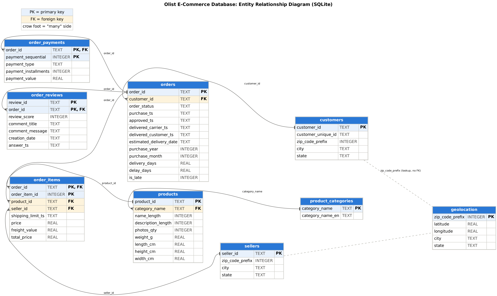

# Olist E-Commerce ETL Pipeline

An end-to-end **ETL (Extract, Transform, Load) pipeline** built with Python, Pandas and SQLite.
It takes the raw Olist Brazilian e-commerce data (9 CSV files), explores and cleans it, loads it into a
relational database with 9 related tables, and answers business questions with Pandas and SQL.

```
Raw Data → Extract → EDA → Clean → Transform → Analyze → Load → SQL Reports → Insights
```

## Dataset

**Brazilian E-Commerce Public Dataset by Olist** (Kaggle):
https://www.kaggle.com/datasets/olistbr/brazilian-ecommerce

- 99,441 orders from 2016 to 2018, in 9 CSV files and 52 columns
- Covers orders, order items, customers, products, sellers, payments, reviews, geolocation and category translations
- Money values are in Brazilian reais (R$)

The raw files are not stored in this repository (large and owned by Kaggle). Download them from the link above.

## Project structure

```
ecommerce-etl-pipeline/
├── data/
│   ├── raw/                  # the 9 original CSV files (you download them, never edited)
│   └── processed/            # cleaned tables written by the pipeline
├── src/                      # the pipeline, one module per step
│   ├── config.py             # paths, file names, date columns
│   ├── extract.py            # read the 9 CSV files
│   ├── eda.py                # exploratory analysis on the raw data
│   ├── clean.py              # cleaning, one function per group of tables
│   ├── quality.py            # 13 automatic quality checks
│   ├── transform.py          # analysis tables (sales, order_totals, customer_orders)
│   ├── analyze.py            # 7 business questions, charts, insights
│   ├── load.py               # create the SQLite database and load the tables
│   ├── reports.py            # run the SQL reports and cross-check with Pandas
│   ├── report_writer.py      # write the combined .sql file and the project report
│   └── utils.py, plotting.py, state.py
├── notebooks/
│   └── olist_etl_analysis.ipynb   # the same pipeline with explanations: EDA → cleaning → analysis → load → SQL
├── sql/
│   ├── schema.sql            # tables, primary keys, foreign keys, constraints, indexes
│   ├── reports.sql           # 11 SQL reporting queries
│   └── olist_ecommerce.sql   # schema + reports in one file (created by the pipeline)
├── tests/                    # small tests for the helper functions
├── docs/
│   ├── ERD.png / ERD.md      # entity relationship diagram
│   ├── Project_Report.md     # project report (created by the pipeline)
│   ├── sql_report_results.md # every SQL query with its output (created by the pipeline)
│   └── figures/              # charts (created by the pipeline)
├── outputs/sql_reports/      # one CSV per SQL report (created by the pipeline)
├── database/olist.db         # SQLite database (created by the pipeline, not in git)
├── run_pipeline.py           # runs all steps in order
├── requirements.txt
└── README.md
```

## How to run

1. **Download the data** from Kaggle and put the 9 CSV files in `data/raw/`.
2. **Install the libraries** (Python 3.9 or newer):
   ```
   pip install -r requirements.txt
   ```
3. **Run the pipeline** from the project folder, either way:
   ```
   python run_pipeline.py
   ```
   or open `notebooks/olist_etl_analysis.ipynb` and choose **Run All**.
4. **(Optional) run the tests:** `pip install -r requirements-dev.txt` then `python -m pytest`.

The database is rebuilt from scratch on every run, so anyone can recreate the same tables and data.

## Pipeline steps

| Step | What happens |
|---|---|
| **Extract** | Read the 9 CSV files with Pandas; the raw files are never changed |
| **EDA** | Shape, data types, samples, statistics, unique values, nulls, duplicates, wrong types, invalid values, outliers, unexpected categories, charts |
| **Clean** | Dates to datetime, remove duplicates, fix text (spaces, accents, capitals), handle missing values, fix invalid values, translate categories, shrink 1M geolocation rows to one row per zip prefix, remove orphan rows |
| **Quality checks** | 13 automatic checks (unique keys, no negative prices, valid scores, parents exist). The pipeline stops if one fails |
| **Transform** | New columns (`delivery_days`, `delay_days`, `is_late`, `total_price`, year and month) and analysis tables (`sales`, `order_totals`, `customer_orders`) |
| **Analyze** | 7 business questions answered with Pandas, with charts and written insights |
| **Load** | Create the tables from `sql/schema.sql` and load the DataFrames with SQLAlchemy; verify row counts, foreign keys and integrity |
| **SQL reports** | 11 queries run on the database; results saved as CSV and in `docs/sql_report_results.md` |

## Database design

9 related tables with primary keys, foreign keys and CHECK constraints. See `docs/ERD.png` and `sql/schema.sql`.



| Table | Primary key | Foreign keys |
|---|---|---|
| customers | customer_id | |
| sellers | seller_id | |
| geolocation | zip_code_prefix | |
| product_categories | category_name | |
| products | product_id | category_name → product_categories |
| orders | order_id | customer_id → customers |
| order_items | (order_id, order_item_id) | order_id → orders, product_id → products, seller_id → sellers |
| order_payments | (order_id, payment_sequential) | order_id → orders |
| order_reviews | (review_id, order_id) | order_id → orders |

## SQL reports (`sql/reports.sql`)

1. Revenue by product category
2. Monthly revenue and number of orders
3. Top 10 customers by spend
4. Top 10 sellers by revenue (`HAVING`)
5. Average order value (subquery)
6. Sales by customer state
7. Late vs on-time deliveries and their review scores (`CASE`)
8. Products with revenue above the average (CTE + subquery)
9. Payment type share (window function)
10. Month-over-month revenue growth (`LAG`)
11. Best-selling category in each top state (`RANK`)

## Results

After a run, the key insights are printed at the end of section 4 of the notebook and written into
`docs/Project_Report.md`. Charts are saved in `docs/figures/`.

## Tools

Python · Pandas · NumPy · Matplotlib · SQLAlchemy · SQLite · SQL · Jupyter

## Author

Bipana Khadka, King's College Nepal (Westcliff University BSCS)

Data: Olist and Kaggle, used for learning purposes.
