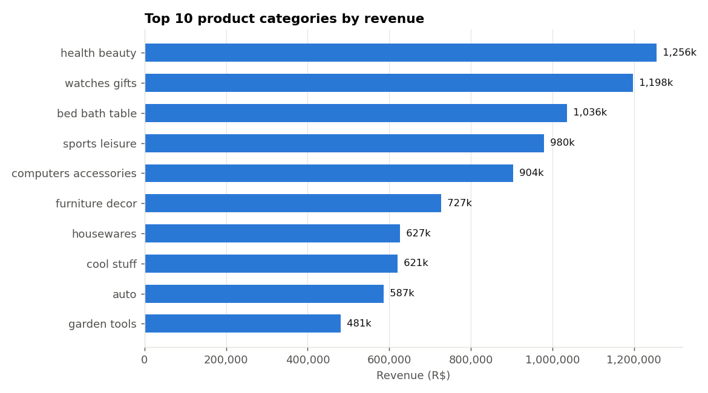
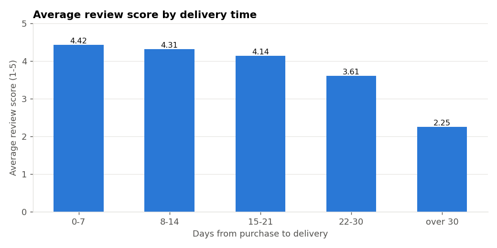

# Olist E-Commerce ETL Pipeline

An end-to-end ETL pipeline in Python. It takes the raw Olist Brazilian e-commerce data (9 CSV files), explores and cleans it, loads it into a relational SQLite database with 9 related tables, and answers business questions with Pandas and SQL.

```
Raw CSV -> Extract -> EDA -> Clean -> Quality checks -> Transform -> Analyze -> Load -> SQL reports -> Insights
```

## Tech Stack

| Layer | Technology |
|---|---|
| Language | Python 3.9+ |
| Data processing | Pandas, NumPy |
| Charts | Matplotlib |
| Database | SQLite via SQLAlchemy |
| Querying | SQL (joins, CTEs, window functions) |
| Notebook | Jupyter |
| Testing | pytest |

## Dataset

**Brazilian E-Commerce Public Dataset by Olist** (Kaggle): https://www.kaggle.com/datasets/olistbr/brazilian-ecommerce

- 99,441 orders from 2016 to 2018, in 9 CSV files and 52 columns
- Covers orders, order items, customers, products, sellers, payments, reviews, geolocation and category translations
- Money values are in Brazilian reais (R$)

The raw files are not stored in this repository (large and owned by Kaggle). Download them and put them in `data/raw/`.

## Prerequisites

- Python 3.9 or newer
- Git
- The 9 Olist CSV files from Kaggle

## Getting Started

```bash
# clone the repo
git clone https://github.com/bipana-aa/olist-etl-results.git
cd olist-etl-results

# create and activate a virtual environment
python -m venv .venv
.venv\Scripts\activate          # Windows
source .venv/bin/activate       # macOS / Linux

# install dependencies
pip install -r requirements.txt

# put the 9 CSV files from Kaggle in data/raw/

# run the whole pipeline
python run_pipeline.py
```

You should see the cleaning log, the 13 quality checks passing, the load check, the SQL reports, and at the end:

```
Load verified: all row counts match, 0 foreign key problems, integrity check = 'ok'.
Pandas and SQL agree.
PIPELINE COMPLETE: raw data extracted, cleaned, loaded into olist.db and reported.
```

You can also open `notebooks/olist_etl_analysis.ipynb` and choose **Run All** for the same pipeline with written explanations.

### What a run creates

| Output | Location |
|---|---|
| SQLite database (9 tables) | `database/olist.db` |
| Cleaned tables (CSV) | `data/processed/` |
| Charts | `docs/figures/` |
| Written project report | `docs/Project_Report.md` |
| Every SQL query with its result | `docs/sql_report_results.md` |
| One CSV per SQL report | `outputs/sql_reports/` |
| Schema + reports in one file | `sql/olist_ecommerce.sql` |

The database is rebuilt from scratch on every run, and the raw files are never changed.

## Project Structure

```
olist-etl-results/
├── src/
│   ├── __init__.py         makes src/ a Python package
│   ├── config.py           paths, file names, date columns
│   ├── extract.py          reads the 9 CSV files
│   ├── eda.py              exploratory analysis on the raw data
│   ├── clean.py            cleaning, one function per group of tables
│   ├── quality.py          13 automatic quality checks
│   ├── transform.py        analysis tables (sales, order_totals, customer_orders)
│   ├── analyze.py          7 business questions, charts, insights
│   ├── load.py             creates the SQLite database and loads the tables
│   ├── reports.py          runs the SQL reports and cross-checks with Pandas
│   ├── report_writer.py    writes the combined .sql file and the project report
│   ├── utils.py            logging, text cleaning, markdown tables
│   ├── plotting.py         chart style and save helper
│   └── state.py            numbers and messages collected during a run
├── sql/
│   ├── schema.sql          all CREATE TABLE statements, keys, constraints, indexes
│   └── reports.sql         11 reporting queries
├── notebooks/
│   └── olist_etl_analysis.ipynb   the pipeline with explanations
├── tests/
│   └── test_helpers.py     tests for the helper functions
├── docs/
│   ├── ERD.png / ERD.md    entity relationship diagram
│   ├── Project_Report.md   written report (created by the pipeline)
│   ├── sql_report_results.md   every SQL query with its output (created by the pipeline)
│   └── figures/            charts (created by the pipeline)
├── data/
│   ├── raw/                the 9 original CSV files (you add them)
│   └── processed/          cleaned tables (created by the pipeline)
├── outputs/sql_reports/    one CSV per SQL report (created by the pipeline)
├── database/               olist.db (created by the pipeline, not in git)
├── run_pipeline.py         runs all steps in order
├── requirements.txt        Python dependencies
├── requirements-dev.txt    test dependencies
└── README.md
```

## Module Reference

### run_pipeline.py

Entry point. `main()` runs every step in order: extract, EDA, clean, quality checks, transform, analyze, load, SQL reports, cross-check, write project files.

### src/extract.py

- `extract(raw_dir)` reads the 9 CSV files into a dictionary of DataFrames

### src/eda.py

- `run_eda(raw)` runs all EDA steps on the raw data
- `explore_basics(raw)` size, columns, data types, samples, unique counts
- `check_data_quality(raw)` missing values, duplicates, wrong types, invalid values, outliers
- `explore_business(raw)` first business look and three charts
- `iqr_outliers(series)` counts outliers with the IQR rule

### src/clean.py

- `clean_all(raw)` runs every cleaning step and returns the clean tables
- `clean_orders`, `clean_customers_sellers`, `clean_products_categories`, `clean_items_payments_reviews`, `clean_geolocation`
- `remove_orphans(...)` removes child rows whose parent row does not exist
- Every step is written to a log with its reason

### src/quality.py

- `run_quality_checks(tables)` runs 13 checks (unique keys, no negative prices, valid scores, parents exist). The pipeline stops if one fails

### src/transform.py

- `build_analysis_tables(tables)` builds `sales`, `order_totals` and `customer_orders`
- `save_processed(tables)` writes the clean tables to `data/processed/`

### src/analyze.py

- `run_analysis(...)` answers 7 business questions with Pandas, saves charts and writes insights

### src/load.py

- `build_load_plan(tables)` lists the tables to load, parents first
- `create_database()` deletes the old database and creates tables from `sql/schema.sql`
- `load_tables(engine, load_plan)` loads every DataFrame
- `verify_load(...)` checks row counts, foreign keys and database integrity

### src/reports.py

- `run_sql_reports(engine)` runs every query in `sql/reports.sql` and saves each result
- `cross_check(...)` the SQL answers must match the Pandas answers

### src/report_writer.py

- `write_project_files(sql_results)` writes `sql/olist_ecommerce.sql`, `docs/sql_report_results.md` and `docs/Project_Report.md`

## Database

9 related tables with primary keys, foreign keys and CHECK constraints. See `sql/schema.sql`.


| Table | Primary key | Foreign keys |
|---|---|---|
| customers | customer_id | |
| sellers | seller_id | |
| geolocation | zip_code_prefix | |
| product_categories | category_name | |
| products | product_id | category_name -> product_categories |
| orders | order_id | customer_id -> customers |
| order_items | (order_id, order_item_id) | order_id -> orders, product_id -> products, seller_id -> sellers |
| order_payments | (order_id, payment_sequential) | order_id -> orders |
| order_reviews | (review_id, order_id) | order_id -> orders |

## SQL Reports

The 11 queries in `sql/reports.sql`:

1. Revenue by product category
2. Monthly revenue and number of orders
3. Top 10 customers by spend
4. Top 10 sellers by revenue (HAVING)
5. Average order value (subquery)
6. Sales by customer state
7. Late vs on-time deliveries and their review scores (CASE)
8. Products with revenue above the average (CTE + subquery)
9. Payment type share (window function)
10. Month-over-month revenue growth (LAG)
11. Best-selling category in each top state (RANK)

## Key Findings

Fill these in from `docs/Project_Report.md` after a run.

| Question | Finding |
|---|---|
| Top category by revenue | XX (R$ XX, XX% of sales) |
| Best month | XX (R$ XX) |
| State with most customers | XX (XX% of customers) |
| Most used payment method | XX (XX% of money paid) |
| Average order value | R$ XX (median R$ XX) |
| Late vs on-time review score | X.XX vs X.XX |
| Customers who buy again | XX% |




## Testing

```bash
pip install -r requirements-dev.txt
python -m pytest
```

Checklist after a run:

- [ ] Pipeline ends with "PIPELINE COMPLETE"
- [ ] All 13 quality checks pass
- [ ] Row counts match between DataFrames and database
- [ ] 0 foreign key problems, integrity check is "ok"
- [ ] 11 SQL reports saved in `outputs/sql_reports/`
- [ ] Pandas and SQL agree on top category and average order value
- [ ] Charts saved in `docs/figures/`
- [ ] `docs/Project_Report.md` created

## Commands Reference

```
python run_pipeline.py              run the whole pipeline
python -m pytest                    run the tests
jupyter notebook                    open the notebook
```

## Author

Bipana Khadka, King's College Nepal (Westcliff University BSCS)

Data: Olist and Kaggle, used for learning purposes.
