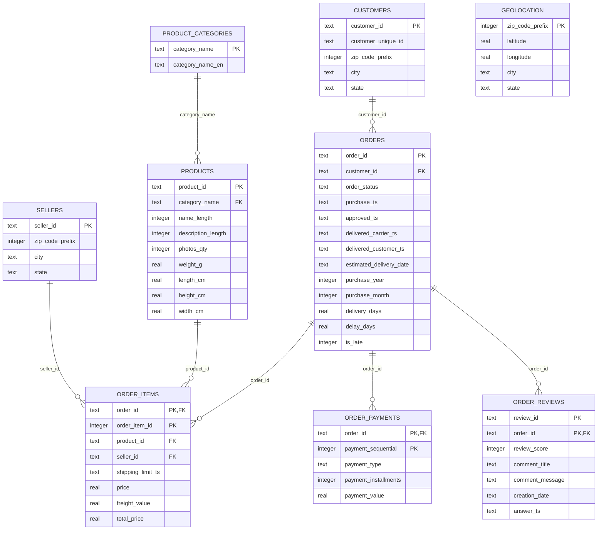

# Entity Relationship Diagram

Picture: `ERD.png`. The diagram below is the same design in Mermaid (GitHub draws it automatically).

**Reading it:** a customer places many orders; an order has many items, payments and reviews; a product belongs to one category; a seller sells many items. `geolocation` is a lookup table joined by `zip_code_prefix` without a foreign key (some zip codes in customers and sellers are missing from the raw geolocation file).
