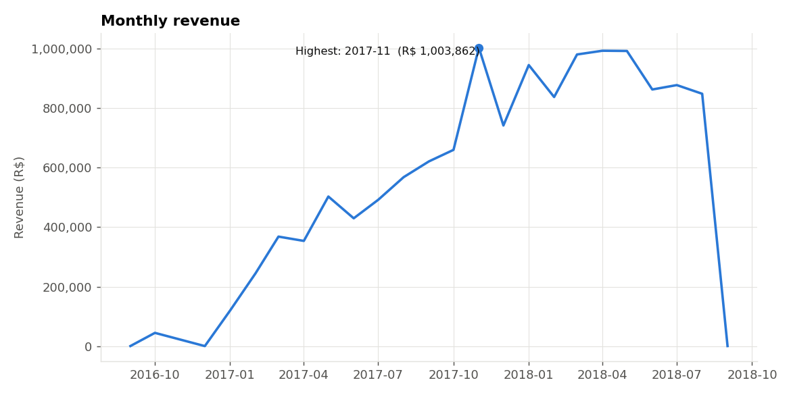

# Project Report: End-to-End ETL & Data Analysis Pipeline

**Student:** Bipana Khadka
**Dataset:** Brazilian E-Commerce Public Dataset by Olist (Kaggle)
**Tools:** Python, Pandas, Matplotlib, SQLAlchemy, SQLite, SQL

## 1. Dataset and Source
The data comes from the public Kaggle dataset *Brazilian E-Commerce Public Dataset by Olist*
(https://www.kaggle.com/datasets/olistbr/brazilian-ecommerce). It describes orders placed on a Brazilian online
marketplace between 2016-09-04 and 2018-10-17. It has **9 CSV files, 52 columns and 1,550,922 rows** in total,
including **99,441 orders**. The files cover orders, order items, customers, products, sellers, payments, reviews,
geolocation and a category translation table. Money is in Brazilian reais (R$).

## 2. Objective
Build a complete and repeatable ETL pipeline: extract the raw files, explore and clean them with Python and Pandas,
transform them into related tables, load them into a relational SQLite database, and use SQL and Pandas to find business
insights about sales, customers, payments and delivery.

## 3. Extraction
All 9 CSV files are read with `pandas.read_csv` into DataFrames. The original files in `data/raw/` are never edited;
all cleaning is done on copies.

| file | rows | columns |
|---|---|---|
| orders | 99441 | 8 |
| customers | 99441 | 5 |
| order_items | 112650 | 7 |
| payments | 103886 | 5 |
| reviews | 99224 | 7 |
| products | 32951 | 9 |
| sellers | 3095 | 4 |
| geolocation | 1000163 | 5 |
| category_translation | 71 | 2 |

## 4. EDA Findings
- The busiest month in the raw data was **2017-11** with 7,544 orders (see `docs/figures/01_orders_per_month.png`).
- 57.8% of all reviews give 5 stars, so most customers are satisfied.
- The median item price is R$ 74.99, with a long tail of expensive items.
- `customer_id` is created for every order, while `customer_unique_id` identifies the real person: there are 99,441 customer ids but only 96,096 real customers.
- Customers come from 27 states, and 73 product categories exist.

## 5. Data Quality Issues Found
**Missing values (largest):**

| table | column | missing | missing_pct |
|---|---|---|---|
| reviews | review_comment_title | 87656 | 88.34 |
| reviews | review_comment_message | 58247 | 58.70 |
| orders | order_delivered_customer_date | 2965 | 2.98 |
| orders | order_delivered_carrier_date | 1783 | 1.79 |
| products | product_category_name | 610 | 1.85 |
| products | product_description_lenght | 610 | 1.85 |
| products | product_name_lenght | 610 | 1.85 |
| products | product_photos_qty | 610 | 1.85 |

**Other issues:**
- 8 date columns were stored as plain text.
- Duplicates: the reviews file has 0 repeated (review_id, order_id) pairs, and the geolocation file has 261,831 fully duplicated rows.
- Invalid values: 3 payments with type not_defined, 2 payments with 0 installments, 4 products with weight 0 g.
- 2 product categories had no English translation.
- City names had accents, extra spaces and mixed capital letters.
- Outliers: very expensive items exist, but they are real purchases, so they were kept.

## 6. Cleaning and Transformation
Every step is based on a problem found during EDA:

| Table | What was done | Rows affected | Why |
|---|---|---|---|
| orders | date columns converted from text to datetime | 5 | text dates cannot be sorted, grouped by month or subtracted |
| orders | new columns: purchase_year, purchase_month, delivery_days, delay_days, is_late | 99441 | needed to answer questions about monthly trends and late deliveries |
| customers | city names standardised (spaces, accents, capital letters) | 99441 | 'sao paulo', 'São Paulo' and 'SAO PAULO ' must be one group in reports |
| sellers | city names standardised (spaces, accents, capital letters) | 3094 | same reason as customer cities |
| products | missing category set to 'unknown' | 610 | removing them would delete real sales |
| products | weight of 0 g treated as missing | 4 | a product cannot weigh 0 g |
| products | missing name_length filled with the median | 610 | keeps the row; median is safe against outliers |
| products | missing description_length filled with the median | 610 | keeps the row; median is safe against outliers |
| products | missing photos_qty filled with the median | 610 | keeps the row; median is safe against outliers |
| products | missing weight_g filled with the median | 6 | keeps the row; median is safe against outliers |
| products | missing length_cm filled with the median | 2 | keeps the row; median is safe against outliers |
| products | missing height_cm filled with the median | 2 | keeps the row; median is safe against outliers |
| products | missing width_cm filled with the median | 2 | keeps the row; median is safe against outliers |
| product_categories | categories without an English name added (underscores -> spaces) | 3 | these categories had no translation: ['pc_gamer', 'portateis_cozinha_e_preparadores_de_alimentos', 'unknown'] |
| order_items | shipping_limit_ts converted to datetime | 112650 | text dates cannot be used in calculations |
| order_items | price outliers kept (checked, not removed) | 8427 | high prices are genuine purchases (for example furniture, appliances), not errors |
| order_items | new column total_price = price + freight_value | 112650 | needed for order value reports |
| payments | rows with payment_type 'not_defined' removed | 3 | the payment method is unknown, so the row carries no information |
| payments | installments of 0 changed to 1 | 2 | a payment has at least 1 installment |
| reviews | date columns converted to datetime | 2 | text dates cannot be used in calculations |
| geolocation | fully duplicated rows removed | 261831 | identical rows add nothing |
| geolocation | points outside Brazil removed | 33 | wrong coordinates are outliers |
| geolocation | 1,000,163 raw rows reduced to one row per zip prefix | 19010 | one averaged coordinate per zip code is enough for maps and joins |

New analysis tables: `sales` (one row per sold item), `order_totals` (one row per order) and `customer_orders` (one row per real customer with a segment).
13 automatic quality checks must pass before anything is loaded.

## 7. Database Design
The database has **9 related tables**: customers, sellers, geolocation, product_categories, products, orders, order_items, order_payments, order_reviews.
Each table has a primary key, and foreign keys link them (customer, then orders, then items / payments / reviews; products and sellers, then items;
category, then products). CHECK constraints protect the data (for example price at least 0, review score 1 to 5, valid order status and payment type).
The ERD is in `docs/ERD.png` and the SQL is in `sql/schema.sql`.

## 8. ETL Process
1. **Extract:** read the 9 CSV files with Pandas.
2. **Transform:** explore, check quality, clean and build new columns with Pandas.
3. **Load:** delete the old database, create the tables from `schema.sql`, and load the DataFrames with SQLAlchemy (`to_sql`) in parent-before-child order.
4. **Verify:** row counts, foreign key check and integrity check.
5. **Report:** run the SQL queries and save the results.

Loaded rows: geolocation 19,010, customers 99,441, sellers 3,095, product_categories 74, products 32,951, orders 99,441, order_items 112,650, order_payments 103,883, order_reviews 99,224.
The whole process is repeatable with `python run_pipeline.py` (or by running the notebook).

## 9. Data Analysis
Seven questions were answered with Pandas: top categories by revenue, the best month, customers by state, payment methods,
average order value, delivery time versus reviews, and repeat customers.

## 10. Key Insights
1. 'health_beauty' is the top category: R$ 1,255,695 of revenue, 9.31% of all sales. The 5 biggest categories together make up 39.8% of revenue, so sales are spread across many categories.
2. 2017-11 had the highest revenue (R$ 1,003,862), 1.8 times the average month (R$ 562,267).
3. SP has the most customers (40,302, 41.9% of all). The top 3 states (SP, RJ, MG) hold 66.5% of customers.
4. 'credit_card' is the most used payment method: 78.3% of all money paid, with 3.5 installments on average.
5. The average order value is R$ 160.24 and the median is R$ 105.28: a few expensive orders pull the average up, so the typical customer spends less than the average suggests.
6. 6.7% of delivered orders arrived after the estimated date. Late orders score 2.27 on average, against 4.29 for on-time orders: slow delivery clearly hurts customer satisfaction.
7. Average review score is 4.42 when delivery takes up to 7 days and 2.25 when it takes over 30 days.
8. 3.0% of customers ordered more than once; they bring 5.7% of revenue. Most customers buy a single time, so repeat-purchase campaigns are a big growth opportunity.

## 11. SQL Reports
11 queries (see `sql/reports.sql`; results in `docs/sql_report_results.md` and `outputs/sql_reports/`):

1. **01_revenue_by_category**: Which product categories generate the most revenue?
2. **02_monthly_revenue_and_orders**: How do revenue and the number of orders change month by month?
3. **03_top_10_customers_by_spend**: Which 10 customers spend the most? (customer_unique_id = the real person)
4. **04_top_10_sellers_by_revenue**: Which sellers earn the most (sellers with at least 10 orders)?
5. **05_average_order_value**: What is the average order value (items + freight)?
6. **06_sales_by_customer_state**: Which states buy the most, and how much does each order cost there?
7. **07_late_vs_on_time_deliveries**: Are late deliveries rated worse than on-time ones?
8. **08_products_with_revenue_above_average**: Which products earn more than the average product?
9. **09_payment_type_share**: How do customers pay, and what share of money does each method carry?
10. **10_month_over_month_growth**: By what percent did revenue grow or fall versus the previous month?
11. **11_top_category_in_each_state**: What is the best-selling category in each of the top 10 revenue states?

## 12. Challenges Encountered
- **Repeated review ids:** 814 review_id values appear more than once, so `review_id` alone cannot be a primary key. A composite key (review_id, order_id) was used.
- **Customer identity:** `customer_id` changes with every order, so customer analysis uses `customer_unique_id`.
- **Huge geolocation file:** it has 1,000,163 rows with many repeated zip codes. It was reduced to 19,010 rows (one per zip prefix). A foreign key from customers to it was not used because some customer zip codes are not in the file.
- **Missing translations and categories:** some products had no category and some categories had no English name; these were handled with an 'unknown' category and a readable fallback name.
- **Dates as text:** all date columns had to be converted before delivery time and monthly trends could be calculated.
- **Keeping the load repeatable:** the database is deleted and rebuilt on each run, with foreign keys switched on so mistakes are caught immediately.

## 13. Conclusion
The project turns 1,550,922 rows of raw marketplace data across 9 files into a clean, validated, relational database and a set of
reports. It shows the complete path: Raw Data, Extract, Explore, Clean, Transform, Analyze, Load, SQL Reports. The business findings
(see Key Insights) show where revenue comes from, how customers pay, and how delivery speed affects satisfaction.
Possible next steps: scheduling the pipeline (for example with Airflow), loading into PostgreSQL, and building a dashboard.
